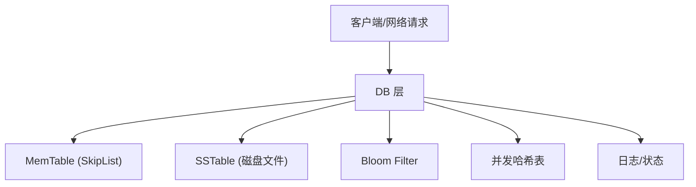

# 简易 LevelDB 实现

## 项目简介

本项目为 LevelDB 的简易版实现，涵盖了高性能 KV 存储引擎的核心原理与模块。项目采用 C++ 编写，模块化设计，支持内存表、SSTable、布隆过滤器、并发哈希表、网络接口等功能，适合学习、研究和面试展示。

## 目录结构

```
简易leveldb代码实现/
├── common/      # 通用工具与基础设施
├── db/          # 数据库核心逻辑
├── disk/        # 磁盘存储与文件格式
├── memory/      # 内存表与数据结构
├── network/     # 网络接口与协议
├── type/        # 基础类型与Slice封装
├── util/        # 工具类与辅助功能
├── main.cpp     # 程序入口
├── CMakeLists.txt
```

## 核心模块介绍

### 1. 内存表（MemTable）
- 基于 SkipList 实现，支持高效的插入、查找、删除。
- 写入数据首先进入 MemTable，提升写入性能。

### 2. 磁盘存储（SSTable）
- 数据持久化采用 SSTable 格式，顺序写入，支持高效查找。
- 支持 Block、FilterBlock、TableBuilder 等子模块，模拟 LevelDB 的文件组织结构。

### 3. 写前日志（WAL）
- 写入 MemTable 前先追加 `wal.log` 并同步，用于进程异常退出后的恢复。
- 启动时会读取 `manifest` 后重放 WAL 中尚未落盘的 `WriteBatch`。

### 4. 布隆过滤器（Bloom Filter）
- 利用布隆过滤器加速 Key 是否存在的判断，减少磁盘 IO。

### 5. 并发哈希表
- 提供高效的并发读写能力，提升多线程场景下的性能。

### 6. 网络接口
- 支持通过网络协议进行 KV 操作，便于远程调用和分布式扩展。

### 7. 工具与通用模块
- 包含日志、状态管理、编码解码、比较器等基础设施。

## 架构设计图



## 构建与运行

### 依赖环境

- C++11 及以上
- CMake 3.10 及以上
- 支持 Linux/Windows/MacOS

### 构建步骤

```bash
git clone <本项目地址>
cd 简易leveldb代码实现
mkdir build && cd build
cmake ..
make
```

### 运行示例

```bash
./leveldb_simple
```

## 主要特性与亮点

- **模块化设计**：各功能模块独立，便于扩展和维护。
- **底层原理还原**：完整实现 MemTable、SSTable、BloomFilter、并发哈希表等核心机制。
- **网络支持**：支持远程 KV 操作，具备分布式扩展基础。
- **工程化能力**：采用 CMake 构建，代码风格规范，易于集成和二次开发。
- **可读性强**：适合学习 LevelDB 原理、面试讲解和二次开发。

## 适用场景

- 作为学习和理解 LevelDB/存储引擎原理的参考实现
- 作为大厂面试项目展示，体现系统设计与底层实现能力
- 作为 KV 存储引擎的实验平台，便于扩展新特性
